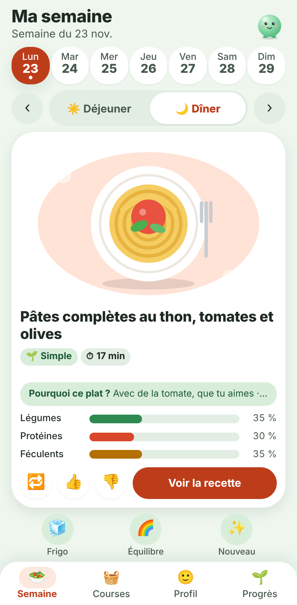
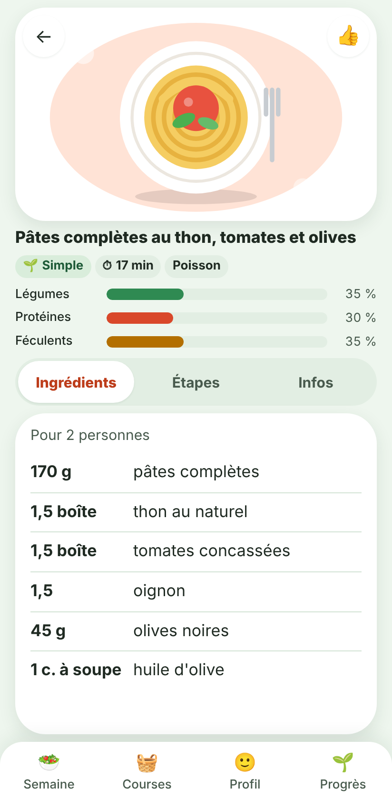
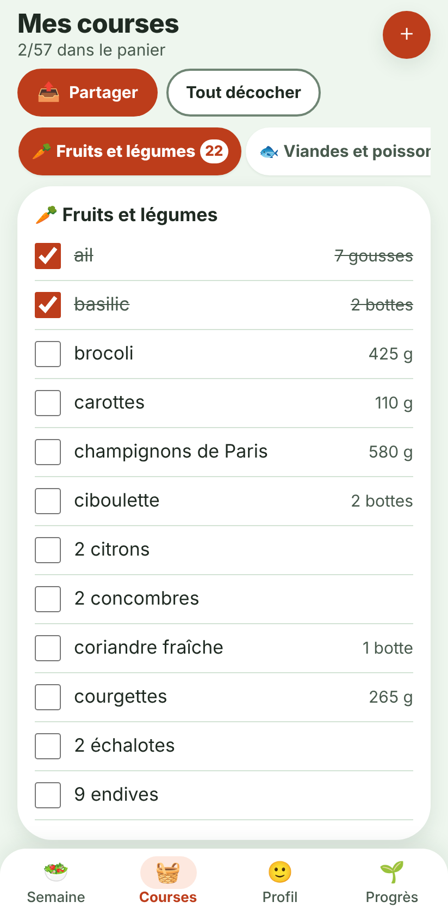
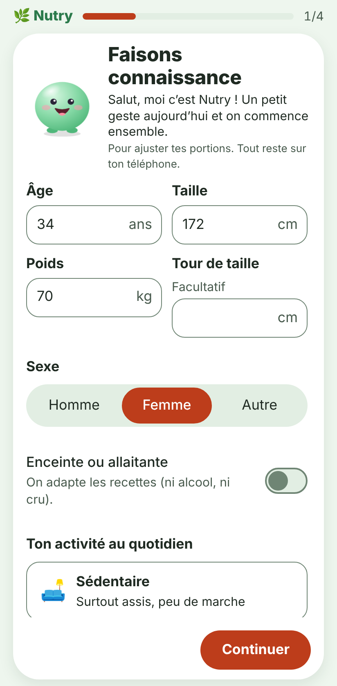
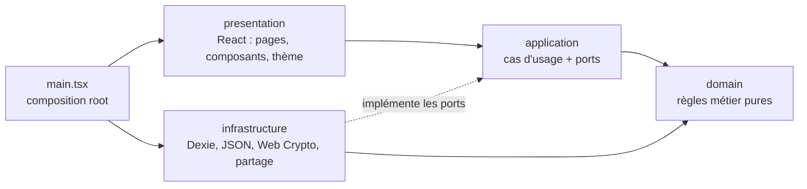

# Nutry — bien manger, en douceur

[](https://github.com/lMcfly/nutry/actions/workflows/ci.yml?query=branch%3Amain)
[](LICENSE)

Nutry t'aide à **rééquilibrer ton alimentation durablement**, sans régime strict ni
culpabilité. Chaque semaine, l'app te propose des repas adaptés à ton profil, à tes goûts, à
tes contraintes et au temps dont tu disposes, puis prépare ta liste de courses. Pas de
comptage de calories : des portions justes et une assiette équilibrée.

**Essayer l'app : <https://lmcfly.github.io/nutry/>**

Nutry est une application web progressive (PWA) : elle s'installe sur ton téléphone comme une
app, fonctionne **hors ligne** et garde **toutes tes données sur ton appareil**.

## Captures

| Ma semaine                                          | Une recette                               | Courses par rayon                                           | Profil et Nutry                                    | Premiers pas                                                     |
| --------------------------------------------------- | ----------------------------------------- | ----------------------------------------------------------- | -------------------------------------------------- | ---------------------------------------------------------------- |
|  |  |  |  |  |

Chaque écran principal tient dans la hauteur du téléphone, **sans défilement de page** : seules
les longues listes (un rayon, les étapes d'une recette) défilent à l'intérieur de leur carte.
Sur la Semaine, on glisse du doigt (ou on touche les boutons ‹ ›) pour passer au repas suivant.

## Fonctionnalités

- **Premiers pas en moins de 2 minutes** : quelques questions (profil, objectif, régime,
  allergies, goûts, foyer, temps disponible), dont une partie peut être passée.
- **Menu de la semaine** : déjeuners et dîners (petit-déjeuner en option), trois niveaux de
  recettes (_Simple_, _Médium_, _Expérimenter_), produits de saison, variété sur la semaine,
  restes et session de batch cooking le dimanche.
- **Remplacer un repas d'un geste** parmi trois alternatives du même niveau, avec une ligne
  « Pourquoi ce plat ? » qui explique chaque proposition.
- **Liste de courses** agrégée par rayon et selon la taille du foyer, à cocher, compléter et
  partager.
- **Mode « frigo vide »** : coche ce que tu as, Nutry propose les recettes possibles.
- **Tes avis comptent** : un 👍 ou un 👎 après un repas ajuste les propositions suivantes, de
  façon simple et explicable.
- **La question du moment** : à chaque ouverture de l'app, une nouvelle question de culture
  générale (dont 20 % de cuisine), jamais deux fois la même avant d'avoir fait le tour, avec
  explication et série de bonnes réponses d'affilée.
- **Progrès** : suivi facultatif du poids et du tour de taille, une fois par semaine au plus,
  avec une tendance lissée qui valorise la régularité. Le poids n'est pas proposé par défaut
  aux profils à protéger (mineurs, grossesse, condition de santé, poids bas), qui peuvent
  l'activer eux-mêmes.
- **Ton Nutry** : un petit compagnon qui récompense la régularité (voir ci-dessous).
- **Thème clair et sombre**, interface mobile d'abord, gros boutons, quatre onglets :
  Semaine, Courses, Profil, Progrès.

## Ton Nutry

Nutry est une petite boule douce qui t'accueille, pose la question du moment, et grandit avec
ta régularité. Elle ne culpabilise jamais : si tu t'absentes, elle fait la sieste, et ton
record comme tes accessoires restent à toi.

- **Un geste par jour** fait vivre la série : répondre à la question du moment, noter un repas
  (👍 ou 👎) ou cocher un article de courses. Ouvrir l'app ne compte pas.
- **Humeurs** : joyeux (geste aujourd'hui), content (geste hier) ou à la sieste (série
  interrompue). Jamais triste.
- **Déblocages sur ton record**, jamais sur la série en cours, donc rien ne se perd :
  la feuille sur la tête dès 1 jour, les lunettes rondes à 3, la toque de chef à 7,
  l'écharpe à 10, le tablier à 14, le bonnet à 21 et la couronne de fruits à 30 ; les teintes
  spéciales Aurore à 5 jours, Cosmos à 15 et Arc-en-ciel à 45. Six teintes et cinq styles
  d'yeux sont là dès le départ.
- **Personnaliser** : depuis le Profil, une feuille plein écran montre un aperçu en direct et
  trois onglets (Couleur, Yeux, Accessoires) ; ce qui n'est pas encore débloqué est grisé avec
  un cadenas et « à N jours de série ».
- **Célébration** : quand Nutry gagne quelque chose, une petite fenêtre festive le fête
  (confettis sobres, coupés si ton téléphone réduit les animations).

Tout le dessin est en SVG (aucune image externe) et les animations légères (flottement,
clignement, petit rebond) respectent `prefers-reduced-motion`. Les choix de conception sont
dans [ADR 0012](docs/adr/0012-compagnon-nutry-et-serie.md) (règles) et
[ADR 0013](docs/adr/0013-refonte-visuelle-sans-scroll.md) (interface).

Le catalogue compte 88 recettes et 464 questions de quiz, toutes en français.

## Installer Nutry sur ton appareil

Ouvre <https://lmcfly.github.io/nutry/> une première fois avec une connexion : l'app se met
en cache et fonctionne ensuite hors ligne.

### Android (Chrome)

1. Ouvre l'adresse dans **Chrome**.
2. Touche le menu **⋮** en haut à droite.
3. Choisis **Installer l'application** (ou **Ajouter à l'écran d'accueil**), puis confirme.

Nutry apparaît parmi tes applications et s'ouvre en plein écran.

### iPhone et iPad (Safari)

1. Ouvre l'adresse dans **Safari** (l'installation n'est pas proposée par les autres
   navigateurs sur les anciennes versions d'iOS).
2. Touche le bouton **Partager** (carré avec une flèche vers le haut).
3. Choisis **Sur l'écran d'accueil**, puis **Ajouter**.

### Ordinateur (Chrome, Edge)

Clique sur l'icône **Installer** à droite de la barre d'adresse (ou menu → **Installer
Nutry**). Sur Mac avec Safari : menu **Fichier → Ajouter au Dock**. Dans les autres
navigateurs, Nutry s'utilise aussi très bien dans un onglet.

### Mises à jour

Quand une nouvelle version est publiée, elle se télécharge en arrière-plan et s'applique
**à la prochaine ouverture de l'app** : jamais pendant que tu l'utilises, donc rien de ce
que tu es en train de saisir n'est perdu. Tes données ne sont pas touchées par une mise à
jour.

## Lancer le projet en local

Prérequis : **Node.js 22.12** ou plus récent (exigé par Vitest 5) et npm.

```bash
git clone https://github.com/lMcfly/nutry.git
cd nutry
npm ci
npm run dev        # http://localhost:5173/nutry/
```

Pour tester la version de production (service worker et hors ligne compris) :

```bash
npm run build
npm run preview    # http://localhost:4173/nutry/
```

### Scripts npm

| Script                    | Rôle                                                                  |
| ------------------------- | --------------------------------------------------------------------- |
| `npm run dev`             | serveur de développement Vite                                         |
| `npm run build`           | valide les données, vérifie les types et construit l'app dans `dist/` |
| `npm run preview`         | sert le build de production                                           |
| `npm run lint`            | ESLint (dont les frontières entre couches), zéro avertissement toléré |
| `npm run typecheck`       | TypeScript strict sur tout le projet                                  |
| `npm run format`          | formate avec Prettier (`format:check` pour vérifier seulement)        |
| `npm test`                | tests unitaires et d'intégration (Vitest)                             |
| `npm run test:coverage`   | idem avec couverture (seuil 90 % sur `domain` et `application`)       |
| `npm run e2e`             | tests de bout en bout Playwright (parcours principal, hors ligne)     |
| `npm run validate-data`   | valide `recipes.json` et `quiz.json` avec leurs schémas Zod           |
| `npm run nutrition:write` | recalcule les valeurs nutritionnelles des recettes depuis Ciqual      |
| `npm run nutrition:check` | signale les écarts nutritionnels sans rien écrire                     |
| `npm run icons`           | régénère les icônes de la PWA depuis `public/favicon.svg`             |

Pour les tests e2e, installe une fois le navigateur : `npx playwright install chromium`.

## Architecture

Nutry suit une **Clean Architecture** en quatre couches (voir
[ADR 0001](docs/adr/0001-clean-architecture-frontieres.md)).



**Règle de dépendance** : `presentation → application → domain` ; l'`infrastructure`
implémente les ports de l'application. Le `domain` et l'`application` n'importent **rien** de
React, du navigateur, du stockage ni d'aucune bibliothèque. Le temps et l'aléa passent par
des ports (`Clock`, `RandomSource`) pour des tests déterministes. Ces règles sont vérifiées
par ESLint (`eslint-plugin-boundaries`) et par des configurations TypeScript séparées.

| Dossier                     | Contenu                                                                 |
| --------------------------- | ----------------------------------------------------------------------- |
| `src/domain/`               | profil, besoins et garde-fous, recettes, menu (scoring), courses, quiz… |
| `src/application/usecases/` | cas d'usage (générer le menu, remplacer un repas, noter, sauvegarder…)  |
| `src/application/ports/`    | interfaces implémentées par l'infrastructure                            |
| `src/infrastructure/`       | IndexedDB (Dexie), catalogues JSON, chiffrement, partage, fichiers      |
| `src/infrastructure/data/`  | `recipes.json`, `quiz.json` et leurs schémas Zod                        |
| `src/presentation/`         | interface React (CSS Modules, thème clair/sombre)                       |
| `src/main.tsx`              | assemblage : seul endroit qui connaît toutes les couches                |
| `data/ciqual/`              | table Ciqual et correspondances d'ingrédients (hors du bundle)          |
| `scripts/`                  | validation des données, calcul nutritionnel, génération des icônes      |
| `e2e/`                      | tests Playwright                                                        |
| `docs/adr/`                 | décisions d'architecture                                                |

Côté déploiement : `HashRouter` et `base: '/nutry/'` pour GitHub Pages
([ADR 0003](docs/adr/0003-routing-hashrouter-github-pages.md)), service worker généré par
`vite-plugin-pwa` qui précache toute l'app, y compris les catalogues chargés à la demande.

## Santé : garde-fous et avertissement

> **Nutry ne remplace pas l'avis d'un médecin ou d'un·e diététicien·ne.** Les propositions
> sont des repères généraux pour manger plus équilibré, pas un traitement ni un régime
> médical.

Les garde-fous sont codés dans le `domain` et testés
([ADR 0007](docs/adr/0007-garde-fous-sante.md)) :

- objectif « perdre en douceur » : déficit plafonné à 15 % des besoins, jamais sous
  1 500 kcal (homme) ou 1 200 kcal (femme) ;
- **aucun déficit** avant 18 ans, pendant une grossesse ou l'allaitement, ou en cas de
  condition de santé déclarée, avec une invitation à consulter ;
- perte désactivée si l'IMC est bas (moins de 18,5, ou de 22 à partir de 70 ans) ;
- pour tous ces profils protégés, le **suivi du poids** est masqué par défaut (la personne
  peut l'activer elle-même) ;
- pendant une grossesse ou l'allaitement, aucune recette avec alcool ou produit cru ;
- **allergies** : exclusion stricte, vérifiée par un test sur l'ensemble des recettes ;
- les calories ne sont pas mises en avant dans l'interface.

## Confidentialité

- **Aucun compte, aucun serveur, aucune donnée envoyée.** Tout est enregistré dans ton
  navigateur (IndexedDB) et l'app ne charge aucune ressource tierce.
- **Sauvegarde** : export en fichier JSON, ou **chiffré** avec une phrase secrète
  (AES-GCM 256 bits, clé dérivée par PBKDF2-SHA256, 600 000 itérations). La phrase n'est
  jamais stockée : si tu l'oublies, la sauvegarde ne peut pas être ouverte.
- **Import** vérifié de bout en bout (taille, format, valeurs plausibles) avant de remplacer
  quoi que ce soit ; **Tout effacer** supprime toutes les données de l'appareil.
- Un rappel doux propose une sauvegarde tous les 30 jours.

Détails : [ADR 0009](docs/adr/0009-persistance-sauvegarde-chiffree.md).

## Ajouter une recette

Les recettes sont dans [`src/infrastructure/data/recipes.json`](src/infrastructure/data/recipes.json).

1. **Ajoute l'objet** en respectant le schéma (validé par Zod au build et par les tests) :

   <!-- prettier-ignore -->
   ```jsonc
   {
     "id": "poelee-pois-chiches-epinards-quinoa", // kebab-case ASCII, unique
     "name": "Poêlée de pois chiches, épinards et quinoa",
     "level": "simple", // simple | medium | experiment
     "prepMinutes": 5,
     "cookMinutes": 15,
     "servings": 2,
     "diets": ["omnivore", "flexitarien", "vegetarien", "vegan", "sans-gluten", "sans-lactose"],
     "allergens": [], // 14 allergènes réglementaires UE
     "mainProtein": "legumineuses",
     "seasons": ["printemps", "automne"],
     "ingredients": [{ "name": "quinoa", "quantity": 120, "unit": "g", "aisle": "epicerie" }],
     "steps": ["Rince le quinoa et fais-le cuire 12 minutes…"],
     "plateBalance": { "vegetables": 0.5, "proteins": 0.25, "starches": 0.25 }, // somme = 1
     "nutritionPerServing": { "kcal": 0, "proteinG": 0, "carbsG": 0, "fatG": 0, "fiberG": 0 },
     "tags": []
   }
   ```

   Les valeurs autorisées (régimes, allergènes, protéines, unités, rayons, étiquettes…) sont
   dans `src/domain/recipe/recipe.constants.ts`. Règles de niveau : _Simple_ ≤ 20 min et
   ≤ 6 ingrédients, _Médium_ entre 20 et 45 min. Étiquette `alcool` ou `cru` obligatoire
   quand c'est le cas ; en cas de doute sur un allergène, il est déclaré
   ([ADR 0008](docs/adr/0008-regles-contenu-allergenes-regimes.md)).

2. **Associe chaque nouvel ingrédient à Ciqual** dans
   [`data/ciqual/ingredients.json`](data/ciqual/ingredients.json) : la clé est le nom
   **exact** de l'ingrédient, avec le `ciqualCode` de l'aliment et, pour une unité non
   massique, `gramsPerUnit` (ex. `{ "gousse": 5 }`). Conventions détaillées dans
   [`data/ciqual/README.md`](data/ciqual/README.md).

3. **Calcule la nutrition** (ne la saisis jamais à la main) :

   ```bash
   npm run nutrition:write
   ```

4. **Vérifie** :

   ```bash
   npm run validate-data   # schémas Zod
   npm test                # audit de contenu, allergènes, régimes, quotas, nutrition
   ```

   L'audit (`src/domain/recipe/audit.ts`) contrôle la cohérence régime ↔ ingrédients, les
   allergènes révélés par les ingrédients, l'équilibre de l'assiette, la vraisemblance
   nutritionnelle et les règles de niveau ; un test génère des menus pour 50 profils et
   vérifie qu'aucune allergie ni aucun régime n'est jamais violé.

## Ajouter une question de quiz

Les questions sont dans [`src/infrastructure/data/quiz.json`](src/infrastructure/data/quiz.json) :

```json
{
  "id": "q-465",
  "question": "Quel fleuve traverse la ville de Lyon avec la Saône ?",
  "choices": ["La Loire", "Le Rhône", "La Garonne", "La Seine"],
  "correctIndex": 1,
  "explanation": "Le Rhône et la Saône se rejoignent à Lyon, au confluent, au sud de la Presqu'île.",
  "category": "geographie",
  "difficulty": "facile"
}
```

- `id` unique, exactement **4 choix** distincts, `correctIndex` de 0 à 3 ;
- `category` : `histoire`, `geographie`, `sciences`, `arts`, `sport`, `nature` ou
  `cuisine` (15 à 25 % de cuisine) ; `difficulty` : `facile`, `moyen` ou `difficile` ;
- un fait **vérifié et sans ambiguïté**, une explication d'une ou deux phrases ;
- puis `npm run validate-data` et `npm test`.

## Contribuer

Les contributions sont les bienvenues : lis [CONTRIBUTING.md](CONTRIBUTING.md). Pour une
idée, une recette ou une question de quiz, ouvre une
[issue](https://github.com/lMcfly/nutry/issues/new/choose).

Le déploiement est décrit dans [docs/DEPLOIEMENT.md](docs/DEPLOIEMENT.md).

## Sources et licences

- **Code** : [licence MIT](LICENSE), © 2026 Les contributeurs de Nutry.
- **Données nutritionnelles** : Anses. 2025. Table de composition nutritionnelle des aliments
  Ciqual. <https://ciqual.anses.fr/> — [Licence Ouverte / Etalab 2.0](https://www.etalab.gouv.fr/licence-ouverte-open-licence/).
  Données utilisées via la conversion JSON
  [LaurentPortefaix/waistline-ciqual](https://github.com/LaurentPortefaix/waistline-ciqual)
  (licence MIT). Les valeurs nutritionnelles des recettes en sont dérivées par calcul.
- Les recettes, les questions du quiz, le logo et les icônes sont distribués sous la même
  licence MIT que le code.
